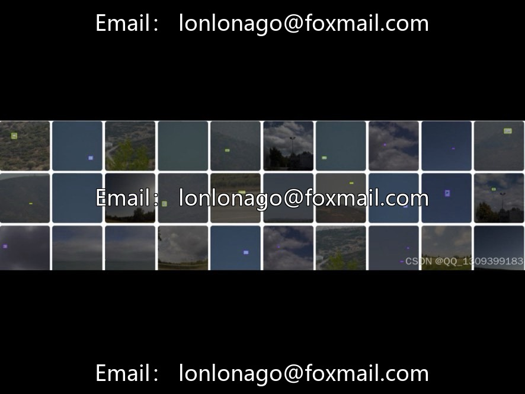
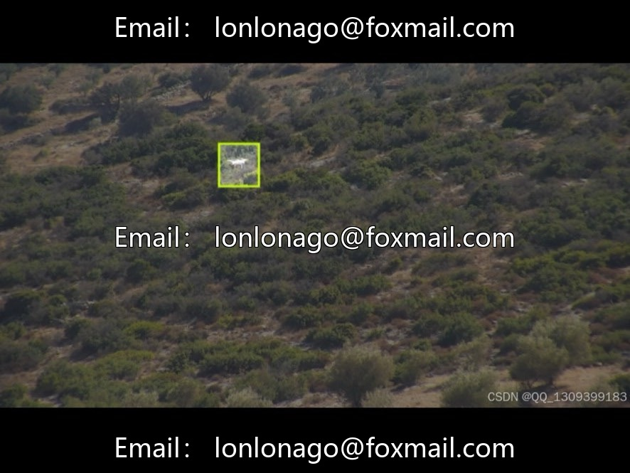

# Drone - 10014th edition of the aerial drone & bird target detection dataset

## Body

Drone vs Bird Binary Classification Aerial Drone and Bird Target Detection Dataset, Issue 10014, Drone Vs Bird. Solving the challenging problem of recognizing drones and birds, suitable for deep learning tasks such as airspace security, surveillance warning, etc.

The dataset consists of 3801 images (3.8k) with mainstream resolutions ranging from 640×480 to 1280×720, bounding box annotations, a reasonable proportion of two types of targets (drone and bird), scenes covering sunny/cloudy/mist days, day/night, urban/wilderness, airports, etc., diverse targets, covering distances and angles at various distances, suitable for model training and algorithm research.

Virtual materials, once sold, are non-refundable.
Interested friends, click "I want" to proceed.

## Images

## Payment

Here is a pay link on Stripe ( https://buy.stripe.com/3cs8yP7sY87d0vu9AB ). Please contact me lonlonago@foxmail.com after funding $89, and I will send you a complete data files , thank you!

